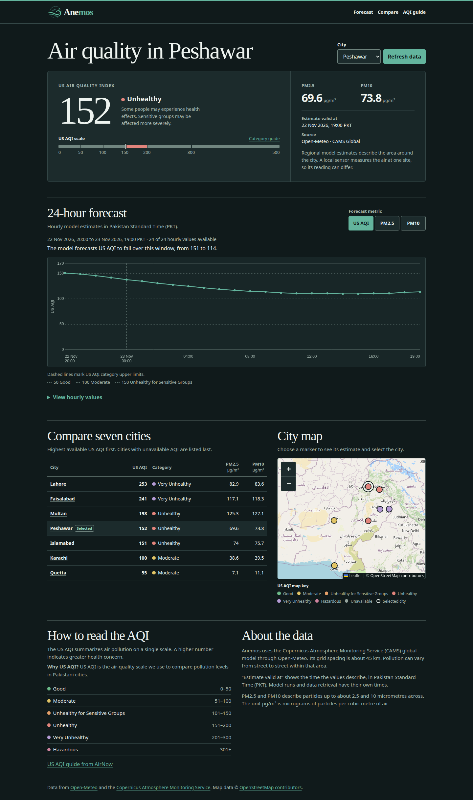
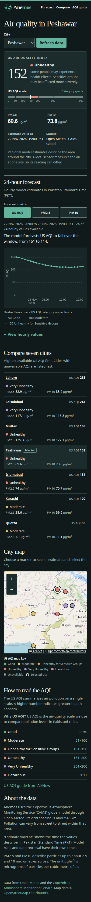

# Anemos — Pakistan Air Quality Analytics

## Project Overview

Anemos is a web dashboard for exploring air quality in seven Pakistani cities. It brings current estimates, short-term forecasts, and city comparisons into one place. Residents, students, and others following air pollution can use it to see how conditions vary across cities and over the next day.

## Features

- View air quality for Peshawar, Lahore, Karachi, Islamabad, Quetta, Multan, and Faisalabad.
- See the US Air Quality Index (AQI), its health category, and PM2.5 and PM10 concentrations in µg/m³.
- Switch between US AQI, PM2.5, and PM10 in the interactive 24-hour forecast chart. An hourly table shows the values in Pakistan Standard Time (PKT).
- Explore an interactive map of Pakistan with selectable city markers that show the available AQI and its category.
- Compare all seven cities in a table ordered by highest available US AQI.
- Use the dashboard on desktop and mobile with a responsive layout.

## Technology Stack

- **Python and FastAPI** serve the dashboard and JSON API. Uvicorn runs the application, and HTTPX fetches air-quality data.
- **HTML, CSS, and JavaScript** build the browser interface. Chart.js renders forecasts, and Leaflet displays the map using OpenStreetMap tiles.
- **Open-Meteo Air Quality API** supplies the current estimates and forecasts from the CAMS global model.

## Project Structure

| Path | Purpose |
| --- | --- |
| `backend/main.py` | FastAPI application, API routes, and Open-Meteo integration |
| `backend/cities.py` | Supported cities and their coordinates |
| `backend/provider_cache.py` | In-memory cache and upstream request limits |
| `backend/security.py` | Security headers and API rate limiting |
| `frontend/index.html` and `frontend/style.css` | Dashboard markup and responsive styles |
| `frontend/app.js` and `frontend/forecast.js` | Dashboard, map, and forecast behavior |
| `frontend/assets/` | Branding images and favicon |
| `tests/test_api.py` | API, caching, and security tests |
| `requirements.txt` | Pinned Python dependencies for the application and tests |

## Local Installation

On Ubuntu, install the prerequisites with `sudo apt install git python3 python3-venv` if needed. Anemos requires Python 3.11 or newer. The setup below was verified on Linux with Python 3.14.

Replace `REPOSITORY_URL` with the clone URL once the repository is published. If you already have the project, run the setup commands from its root.

```sh
git clone REPOSITORY_URL anemos
cd anemos
```

Create and activate a virtual environment, install the dependencies, and start the server.

```bash
python3 -m venv .venv
source .venv/bin/activate
python -m pip install --upgrade pip
python -m pip install -r requirements.txt
python -m uvicorn backend.main:app --host 127.0.0.1 --no-proxy-headers
```

Open <http://127.0.0.1:8000/> in a browser. If port 8000 is in use, add `--port 8001` to the Uvicorn command and open <http://127.0.0.1:8001/>. The dashboard needs internet access for air-quality data, map tiles, and the chart and map libraries.

## Running Tests

From the project root with the virtual environment active, run:

```sh
python -m pytest -q
```

The tests mock Open-Meteo responses and cover API behavior, provider failures, caching, and security controls.

## API Endpoints

| Method and path | Query parameters | Response |
| --- | --- | --- |
| `GET /api/health` | None | Application status and name |
| `GET /api/cities` | None | Supported cities with latitude and longitude |
| `GET /api/air-quality` | Optional `city`. Defaults to `Peshawar`. | Current and hourly US AQI, PM2.5, and PM10 estimates for one city |
| `GET /api/compare` | None | Current US AQI, PM2.5, PM10, and estimate times for all seven cities |

City names are case-insensitive. An unsupported city returns HTTP `400`. For example, `/api/air-quality?city=Lahore` requests estimates for Lahore.

Swagger UI, ReDoc, and the OpenAPI schema are disabled by default. To enable them locally, set `ANEMOS_ENABLE_API_DOCS=1` when starting Uvicorn.

## Data Source and Limitations

Open-Meteo supplies modeled air-quality estimates from the Copernicus Atmosphere Monitoring Service (CAMS) global model. These estimates describe a region around each city. A physical sensor measures conditions at a single location, so actual street-level air quality can differ. Anemos uses the US AQI scale. Data may be delayed, incomplete, or temporarily unavailable. [Open-Meteo Air Quality API](https://open-meteo.com/en/docs/air-quality-api), [CAMS global forecasts](https://ads.atmosphere.copernicus.eu/datasets/cams-global-atmospheric-composition-forecasts?tab=overview)

The dashboard credits Open-Meteo, CAMS, and OpenStreetMap contributors. Anemos uses the free Open-Meteo endpoint, which has non-commercial terms and request quotas. OpenStreetMap's public tile servers have a separate usage policy. [Open-Meteo terms](https://open-meteo.com/en/terms), [OpenStreetMap attribution](https://www.openstreetmap.org/copyright), [Tile usage policy](https://operations.osmfoundation.org/policies/tiles/)

## Security and Reliability

- The API accepts supported city names, uses server-defined coordinates, and validates provider responses. Upstream calls have timeouts, and errors return general messages to clients.
- Each worker caches successful air-quality and comparison results for 10 minutes, shares in-progress fetches for the same data, and limits concurrent Open-Meteo calls. A separate per-worker rate limit covers the city list, air-quality, and comparison endpoints, including cache hits.
- The dashboard uses a Content Security Policy and makes same-origin API requests. The server also sends headers that restrict framing, MIME sniffing, and browser permissions.
- Python dependency versions are pinned in `requirements.txt`. The CDN versions of Chart.js and Leaflet are pinned and loaded with integrity checks.

## Screenshots

Both full-page Chromium captures show Peshawar with live Open-Meteo estimates valid at 19:00 PKT on 22 November 2026.

**Desktop (1440 px)**



**Mobile (390 px)**



## Deployment

Public deployment is pending. Before launch, verify HTTPS and proxy settings, traffic limits, and provider quotas for the expected usage.
